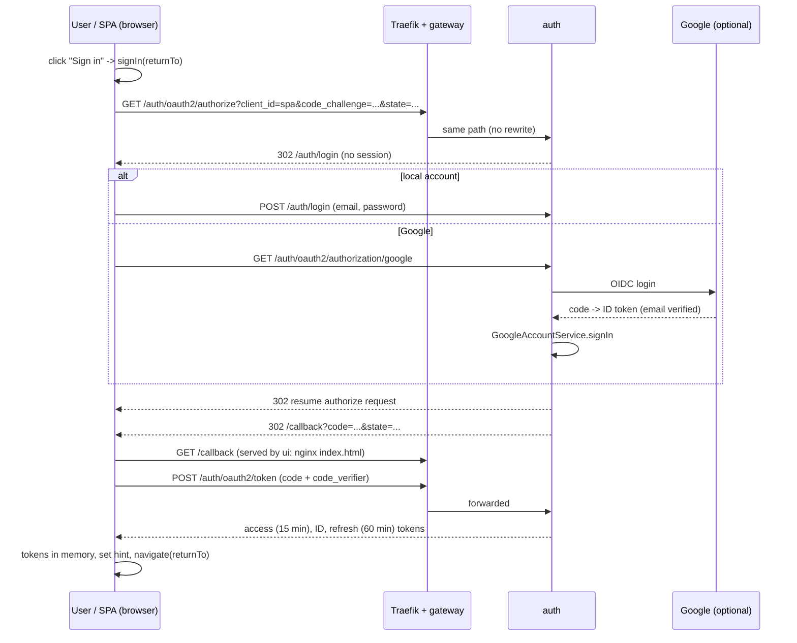
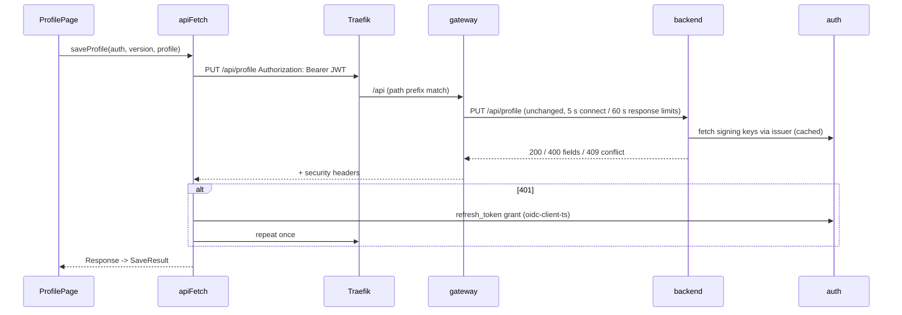

# Architecture: auth, gateway and ui

Read on 2026-10-24. Scope: the three parts that are not `backend/`. Every claim cites a file; anything I did not
confirm in code is marked "unverified". All example values are invented.

## 1. The picture

One public host (`s4v3.net`). The browser only ever talks to that host, so there is no CORS setup
(`openspec/specs/edge-routing/spec.md`).

```
browser
  |  https://s4v3.net
  v
Traefik (Gateway API "edge")                     k8s/base/edge.yaml, k8s/platform/
  |  "/"            -> ui      (nginx, static files)
  |  "/api", "/auth" -> gateway (Spring Cloud Gateway)
  v
gateway :8080                                    gateway/src/main/resources/application.yaml
  |  /api/**  -> backend :8081   (path unchanged)
  |  /auth/** -> auth    :9090   (path unchanged)
  v
backend (JWT resource server)     auth (Spring Authorization Server, db "authdb")
```

Rules enforced in k8s: only Traefik reaches `gateway` and `ui`; only `gateway` reaches `backend`; `gateway` and
`backend` reach `auth`; only `backend` and `auth` reach Postgres (`k8s/base/network-policies.yaml`).

## 2. auth/

Kotlin, Spring Boot 4, Spring Authorization Server, Spring Data JDBC, Liquibase, PostgreSQL
(`auth/build.gradle.kts`). Port 9090, everything under context path `/auth` (`auth/src/main/resources/application.yaml`).
Package `net.s4v3.auth` under `auth/src/main/kotlin/`.

### 2.1 Package map

| Package | What is in it |
|---|---|
| `config/` | `AuthorizationServerConfig` (issuer, the one client, signing key, token generator, password encoder), `SecurityConfig` (three filter chains), `AuthProperties` (the `app.*` settings), `PromptNone` (silent sign-in answer), `LogoutFallback` (sign-out that never ends on a bare 400), `DevSeedData` (dev-only accounts) |
| `user/` | `User` (+ `UserRole`, `Roles`, `Provider`), `UserRepository`, `AccountUserDetailsService` (form login), `UserRegistrationService`, `RegistrationController` (`POST /api/register`) |
| `password/` | reset-by-email and change-password: `PasswordService`, `PasswordController`, `PasswordResetToken(+Repository)`, `ValidPassword` (8 to 72 chars and at most 72 bytes) |
| `google/` | `GoogleLoginConfig` (registers Google only when both credentials are set), `GoogleOidcUserService`, `GoogleAccountService` |
| `token/` | `UserClaimsCustomizer` (adds `roles`, `email`, `name`), `AnyClientRefreshTokenGenerator`, `PublicClientRefresh` (converter + provider) |
| `mail/` | `MailSender` interface, `LoggingMailSender` (logs instead of sending), `Mails` (texts), `AfterCommit` |
| `web/` | `ApiExceptionHandler` maps exceptions to `{error, fields}` JSON |

### 2.2 Local accounts and registration

- `POST /api/register` creates a `LOCAL` user with role `USER`. Email is trimmed and lower-cased; a duplicate gives
  409 `duplicate_email` (`UserRegistrationService.kt`, `ApiExceptionHandler.kt`). Reached by the UI as
  `/auth/api/register` (`ui/src/register/register.ts`).
- Login is Spring's form login with the generated login page; the repository has no `templates/` or `static/` folder
  in `auth/src/main/resources` (listing checked). The login name is the email (`DevSeedData.kt` comment).
- After form login, the saved authorization request is resumed; with none, the browser is sent to `/` with 303
  (`SecurityConfig.loginSuccessHandler`).
- Passwords: `DelegatingPasswordEncoder` (`AuthorizationServerConfig.passwordEncoder`), so the stored hash carries its
  algorithm prefix. The `ValidPassword` comment mentions bcrypt's 72-byte limit.
- Password reset: `POST /api/password-reset/request` always answers 200 with `{"status":"ok"}`. A 32-byte random token is
  created, only its SHA-256 hash is stored (table `password_reset_token`), valid 30 minutes. The link is
  `<app.ui-base-url>/reset-password?token=...`. `POST /api/password-reset/confirm` consumes the token.
  `PUT /api/me/password` changes the password of the token's `sub` (`PasswordService.kt`, `PasswordController.kt`).
- Mail is not sent: `LoggingMailSender` writes the message, reset link included, to the log
  (`mail/MailSender.kt`). An SMTP bean would replace it (`@ConditionalOnMissingBean`).

### 2.3 Google login

- Active only when `app.google.client-id` and `app.google.client-secret` are both non-blank
  (`GoogleCredentialsPresent`). `SecurityConfig.defaultChain` adds `oauth2Login` only if a
  `ClientRegistrationRepository` exists.
- Redirect URI to register at Google: `<public issuer>/login/oauth2/code/google` (`GoogleLoginConfig` comment;
  `k8s/README.md` gives `https://s4v3.net/auth/login/oauth2/code/google`).
- `GoogleOidcUserService` rejects an unverified Google email, then calls `GoogleAccountService.signIn`:
  known Google subject -> that account; else email of a local account -> link it and **discard its password**; else
  create an account with no password. Another Google subject on a linked email is rejected.
- `app.admin-emails`: a Google sign-in whose email is on the list gets `ADMIN` in addition. Computed on every sign-in, never
  stored; local-password accounts never get it (`AuthProperties.kt`, `GoogleOidcUserService.kt`).
- Principal name is the user's UUID (extra `uid` claim), so `sub` is identical for form and Google login.

### 2.4 Tokens, client and redirect URIs

- One client, `spa`, built in code, kept in memory (`InMemoryRegisteredClientRepository`):
  public (no secret), authorization code + refresh token, PKCE required, no consent screen, scopes `openid profile email`.
- Redirect URIs and post-logout URIs come from `app.spa.redirect-uris` / `app.spa.post-logout-redirect-uris`; there are no
  defaults outside profile `dev` and startup fails naming a missing one (`AuthProperties.kt`, `application.yaml`).
  In prod they are `https://s4v3.net/callback` and `https://s4v3.net/` (`k8s/overlays/prod/kustomization.yaml`).
- Lifetimes: access token 15 minutes, refresh token 60 minutes, refresh tokens rotate (`reuseRefreshTokens(false)`)
  (`AuthorizationServerConfig.kt`).
- Issuer is fixed from `app.issuer-uri`, never from the request.
- Claims written by `UserClaimsCustomizer`: `roles` (array, no `ROLE_` prefix) on access tokens; `email` and `name`
  when the scopes were granted. `sub` = user UUID.
- Why `token/` has custom classes: Spring does not issue refresh tokens to public clients and does not let a public
  client present one without credentials. `AnyClientRefreshTokenGenerator` and `PublicClientRefreshConverter/Provider`
  add exactly that case (comments in `AuthorizationServerConfig.kt` and `PublicClientRefresh.kt`).
- `prompt=none` (silent check): if the request names a registered client and an exactly matching registered redirect
  URI and there is no session, answer a redirect with `error=login_required&state=...`; anything else goes to the login
  form (`PromptNone.kt`).
- End-session: `LogoutFallbackHandler` ends the session and redirects to a registered post-logout URI even when the ID
  token is unknown; unregistered URIs stay 400 (`LogoutFallback.kt`).

### 2.5 The three security filter chains (`SecurityConfig.kt`)

1. Order 1, authorization-server endpoints (authorize, token, JWKS, discovery, userinfo, logout). Browsers without a
   session go to `/login`.
2. Order 2, `/api/me/**`: stateless, bearer JWT, no CSRF.
3. Order 3, everything else: form login, optional Google login, CSRF on, except the three open POSTs
   (`/api/register`, `/api/password-reset/request`, `/api/password-reset/confirm`). `/actuator/**` and `/api/**` answer 401
   instead of redirecting. Health probes and `/error` are open.

### 2.6 Keys and what is stored where

- **Signing key:** a 2048-bit RSA key pair is generated in memory at every start (`AuthorizationServerConfig.jwkSource`).
  A restart invalidates all tokens and two replicas would disagree (also `k8s/README.md` section 11). The backend reads
  the keys through the issuer's discovery document (`openspec/specs/edge-routing/spec.md`).
- **PostgreSQL (`authdb`)**, Liquibase changelog `auth/src/main/resources/db/changelog/`: `users` (UUID id, email unique on
  `lower(email)`, nullable password, names, `enabled`, `provider` LOCAL/GOOGLE, `provider_id`), `user_role`,
  `password_reset_token`.
- **In memory only:** the registered client, the signing key, and (as far as the code shows) OAuth authorizations and
  consents: no authorization-service tables exist in the changelog and no `JdbcOAuth2AuthorizationService` is defined.
  The HTTP session for form login is the default servlet session; no session-store dependency is in
  `auth/build.gradle.kts` (the exact default store is unverified, not seen in code). This matches your memory note that
  persistent auth state is a later step.
- **No tokens or Google tokens are stored or logged** (`GoogleOidcUserService` comment; log level for
  `DefaultRedirectStrategy` is pinned to INFO in `application.yaml` so authorization codes stay out of logs).

### 2.7 Health endpoints

Only `health` is exposed. `/auth/actuator/health/liveness` (liveness state only) and `/auth/actuator/health/readiness`
(readiness state + `db`), unauthenticated (`application.yaml`, `SecurityConfig.defaultChain`; `k8s/README.md` section 7).

### 2.8 Configuration

`app.issuer-uri`, `app.ui-base-url`, `app.spa.redirect-uris`, `app.spa.post-logout-redirect-uris` (required);
`app.google.client-id`, `app.google.client-secret`, `app.admin-emails` (optional). Dev profile reads `.env`
(`application-dev.yaml`).

### 2.9 Tests

`auth/src/test/kotlin/net/s4v3/auth/`, about 33 files. Two meta-annotations start the app against a PostgreSQL
Testcontainer: `@IntegrationTest` (plain context) and `@WebIntegrationTest` (random port, real HTTP); both use profile `test`
(`IntegrationTest.kt`, `WebIntegrationTest.kt`). Helpers: `AuthFlow`, `FakeGoogle`, `RecordingMailSender`, `TestUsers`,
`LogCapture`. Test names group by feature: registration, password, Google, token claims, SPA client, logout, silent
check, schema, health, secrets-not-logged, configuration binding.

## 3. gateway/

Spring Cloud Gateway (reactive), port 8080, stateless. Two source files only:
`GatewayApplication.kt` and `DownstreamErrorHandler.kt`. Everything else is `application.yaml`.

### 3.1 Routes

| Predicate | Target | Setting |
|---|---|---|
| `Path=/api/**` | `backend` | `microservices.backend.uri`, default `http://localhost:8081` |
| `Path=/auth/**` | `auth` | `microservices.auth.uri`, default `http://localhost:9090` |

No rewriting. Anything else is a 404. It validates no token and checks no role (`gateway/README.md`).
Settings live under `spring.cloud.gateway.server.webflux` (the older prefix is silently ignored in 5.x);
`GatewayConfigurationTests` asserts the effective values.

### 3.2 Hardening in place

- `SecureHeaders` default filter (spec lists `X-Content-Type-Options`, `X-Frame-Options`, `Referrer-Policy`,
  `Strict-Transport-Security`; the filter's own defaults were not read, unverified), with the Content-Security-Policy
  disabled because the generated login page of `auth` needs inline content (`application.yaml`,
  `openspec/specs/gateway-hardening/spec.md`).
- Connect timeout 5 s, response timeout 60 s; pooled connections idle at most 15 s, living at most 60 s, so replaced pods
  do not leave stale connections (`application.yaml`).
- `DownstreamErrorHandler` (`@Order(-2)`): an `IOException` anywhere in the cause chain (connection refused or dropped)
  becomes `502 {"error":"bad_gateway"}`; only the exception class is logged because its message contains the address.
- Logging: the spec forbids logging bodies, auth headers, cookies, query strings; nothing in `gateway/src/main` logs them
  (only one `log.warn` exists).
- Health: `/actuator/health/liveness` and `/readiness`, neither depends on backend or auth.
- Forwarded headers: `trusted-proxies` is a regex of private and loopback addresses in `application.yaml`, but
  **k8s overrides it to `.*`** (`k8s/base/gateway.yaml`), explained in `k8s/README.md` section 11.

### 3.3 Rate limits

**The gateway has no rate limiting** (no limiter filter in `application.yaml`, none in its two source files). The
limiters that exist are in the backend (`backend/.../AnalysisLimiter.kt`, `ExtractionLimiter.kt`, `ExportLimiter.kt`).
Traefik's own config is `k8s/platform/traefik-values.yaml` (not read in detail, so whether it limits anything is unverified);
`k8s/README.md` mentions only a 60-second read timeout for uploads. The auth endpoints `/api/register` and
`/api/password-reset/request` are open POSTs with no limiter I found in `auth/src/main`.

### 3.4 Relation to Traefik

Traefik is the public edge: TLS (cert-manager, Let's Encrypt), HTTP to HTTPS 301 (`k8s/overlays/prod/redirect.yaml`), host
`s4v3.net`, and path split `/` -> `ui`, `/api` and `/auth` -> `gateway` (`k8s/base/edge.yaml`). The gateway is only a path
router and error-shaper behind it. It trusts forwarded headers from Traefik so `auth` builds public URLs.

### 3.5 Tests

`gateway/src/test/kotlin/net/s4v3/gateway/`: `GatewayTest` base (random port, routes pointed at two `StubService` fake
downstream servers), then `RoutingTests`, `PassThroughTests`, `HardeningTests`, `DownstreamFailureTests`,
`TargetSettingsTests`, `GatewayConfigurationTests`, `RuntimeTests`. No external services needed.

## 4. ui/

React 19 + Vite 8 + TypeScript 6, react-router 8, oidc-client-ts 3, vitest 5 (`ui/package.json`). No state library, no CSS
framework: one `src/index.css`.

### 4.1 Folder map of `ui/src`

| Folder | Content |
|---|---|
| `main.tsx`, `App.tsx` | entry (providers) and the route table |
| `auth/` | `AuthProvider`, `authContext` (`useAuth`), `CallbackPage`, `config` (oidc settings), `hint`, `returnTo` |
| `api/` | `apiFetch` (the one HTTP client), `messages` (status/error to text) |
| `pages/` | `Home`, `Landing` (signed out), `Shell` (signed-in home) |
| `register/` | `RegisterPage`, `register.ts` |
| `profile/` | `ProfilePage`, `ProfileForm`, `fields`, `OpenSourceSection`, `TagInput`, `types`, `rules`, `skills`, `profileApi`, `repositoriesApi`, `analysisApi`, `fixtures/` |
| `cv/` | `cvApi` (extract from the master CV) |
| `files/` | `FileCabinet`, `filesApi`, `format`, `fakeXhr` (test helper living in src) |
| `postings/` | `PostingsPage`, `PostingPage`, `OriginalLinks`, `postingsApi`, `links`, `types` |
| `matches/` | `MatchesPage`, `matchesApi`, `types` |
| `export/` | `ExportPage`, `exportApi`, `options` |
| `admin/` | `AdminPage`, `adminApi`, `roles` |
| `test/` | `setup.ts`, `fakeAuth.ts`, `fakeManager.ts` |

Pattern per feature: `<x>Page.tsx` (UI + state) + `<x>Api.ts` (calls, returns a result union) + optional `types.ts`.

### 4.2 Routing (`App.tsx`)

`/` Home, `/profile`, `/postings`, `/postings/:id`, `/matches`, `/export`, `/admin`, `/register`, `/callback`, and `*` -> Home.
There is no route guard component: each page switches on `useAuth().state` and renders `Landing returnTo=...` when signed
out (e.g. `ProfilePage.tsx`, `PostingsPage.tsx`). `Home` renders Landing or `Shell` by state. The admin link in `Shell`
is shown if the access token has role `ADMIN` (`admin/roles.ts` decodes the JWT without checking the signature; the
backend enforces roles).

### 4.3 Auth flow (oidc-client-ts, PKCE)

Settings (`auth/config.ts`): authority `<origin>/auth`, client `spa`, `response_type=code` (oidc-client-ts adds the PKCE
challenge), scope `openid profile email`, `automaticSilentRenew: true`, `loadUserInfo: false`. Tokens live in an
`InMemoryWebStorage`; only the sign-in `state` and PKCE verifier use `sessionStorage`. One boolean hint
`jh.signedIn` in `localStorage` says "a session probably exists" (`auth/hint.ts`).

Reload: tokens are gone, so if the hint is set `AuthProvider` starts `signinRedirect({prompt:'none'})`; no session at the
auth service returns `login_required`, handled as "signed out" (`AuthProvider.tsx`, `completeSignIn`).

Sign-in sequence:



The login path `/auth/oauth2/authorize` etc. is Spring Authorization Server's default endpoints (unverified in code: no
custom paths are set, and the UI uses oidc-client-ts discovery from `<origin>/auth`).

Renewal: oidc-client-ts renews with the refresh token before expiry; a failed renewal runs `discard()` (signed out).
Sign-out: `signoutRedirect` to the auth end-session endpoint and back to `/`.

### 4.4 API calls (`api/apiFetch.ts`)

`apiFetch(auth, path, init)` where `auth` is a `TokenSource` (`getAccessToken`, `renew`, `discard`, all provided by
`useAuth()`):

1. Path must match `^/api/...` and contain no `..`; otherwise it throws (so the token cannot go to another origin).
2. No token -> `ApiError('unauthorized')`.
3. `fetch` with `Authorization: Bearer ...`, `credentials: 'omit'`. Network failure -> `ApiError('unavailable')`.
4. On 401: renew once, retry once; a second 401 or failed renewal discards tokens and throws `unauthorized`.
5. Any other status is returned to the caller.

Each `<x>Api.ts` turns that into a result union (`loaded` / `unauthorized` / `failed` + short text, sometimes `invalid`,
`conflict`, `notFound`, `forbidden`). `api/messages.ts` holds the fixed texts. Response bodies are never shown.
Exceptions: `register.ts` uses plain `fetch` to `/auth/api/register` (no token yet); `filesApi.uploadFile` uses
`XMLHttpRequest` for progress and repeats the 401-renew logic itself; downloads ask for a ticket and then set
`window.location` to the returned `/api/files/...` path (`filesApi.ts`).

Typical call, a profile save:



### 4.5 Pages and the API they call

| Route | Page | Calls |
|---|---|---|
| `/` | `Home` -> `Landing` or `Shell` | `Shell`: `GET /api/` (health-style check) |
| `/register` | `RegisterPage` | `POST /auth/api/register` (no token) |
| `/callback` | `CallbackPage` | token endpoint via oidc-client-ts |
| `/profile` | `ProfilePage` (+ `FileCabinet`, `OpenSourceSection`) | `GET/PUT /api/profile`, `GET /api/profile/repositories?provider&username`, `POST /api/profile/open-source-projects/analyze`, `POST /api/cv/extract[?section=]`, files calls below |
| (in profile) | `FileCabinet` | `GET /api/files`, `POST /api/files` (XHR), `DELETE /api/files/{id}`, `GET/PUT/DELETE /api/files/master`, `POST /api/files/{id}/download-ticket` |
| `/postings` | `PostingsPage` | `GET /api/postings?page&size&q&canton&source` |
| `/postings/:id` | `PostingPage` | `GET /api/postings/{id}` |
| `/matches` | `MatchesPage` | `GET /api/matches?page&size` |
| `/export` | `ExportPage` | `POST /api/cv/export` (blob back) |
| `/admin` | `AdminPage` | `GET` and `POST /api/admin/crawl-schedule` |

(From the `*Api.ts` files; HTTP methods for `FileCabinet` rows checked in `filesApi.ts`.)

### 4.6 State handling

React `useState`/`useEffect` per page; no store, no data cache, no query library. The only shared state is the auth
context (`AuthProvider`). Filters and paging for postings and matches live in the URL (`useSearchParams`). Every loader
sets a small state union (`loading` / `failed` / `ready`). Because the context value changes with sign-in state, several
pages disable `react-hooks/exhaustive-deps` on purpose so a load runs once per mount (comments in `Shell.tsx`,
`ProfilePage.tsx`).

### 4.7 Profile form architecture (`ui/src/profile/`)

- `types.ts`: the `Profile` shape, enum-like const arrays (`WORK_AUTHORISATIONS`, `LANGUAGE_LEVELS`, ...), `emptyProfile()`,
  `blank*()` row factories, `toRequestProfile()` (trims and tidies before sending).
- `rules.ts`: `checkProfile(profile)` returns `{path: message}` and mirrors the backend `ProfileValidator`
  (same paths and messages, per its comment). Server answer wins.
- `fields.tsx`: small controlled inputs (`Field`, `TextInput`, `NumberInput`, ...) carrying `data-path` for focus and blur.
- `ProfileForm.tsx`: pure presentation, "holds no state of its own": gets `profile`, `onChange`, `errors`, `onLeave`.
- `ProfilePage.tsx`: all state: loaded `version` (optimistic locking, 409 = conflict), draft, last saved snapshot (dirty
  check, `beforeunload` warning), browser-side messages that only show after a field was left, server messages, focus on
  the first error after a failed save, per-section "Fill from CV" (replaces only that section, unsaved until Save).
- `skills.ts`: how analysis results merge into skills.
- Fixture and drift test: `fixtures/full-profile.json` is a copy of `backend/src/test/resources/profile/full-profile.json`
  (same JSON content when sorted; formatting differs, checked with a sorted dump). `profile.test.ts` ("types match the
  backend sample") compares the key sets at each level with `emptyProfile()` and fixed lists. It detects a field added to
  one side only **in the copy**, so it only works if someone refreshes the copy; no automatic sync exists that I found
  (unverified beyond a search of `ui/` and `backend/src` for the file name).

### 4.8 Tests

31 test files, next to the code (`*.test.ts(x)`), vitest with jsdom, setup in `src/test/setup.ts` (jest-dom matchers and
cleanup) (`vite.config.ts`). Styles: pure functions (`rules`, `skills`, `options`, `format`, `links`, `returnTo`), API modules
with a stubbed `fetch` (`*Api.test.ts`), pages with Testing Library and `fakeAuth`/`fakeManager`, one
`FakeXhr` for uploads. Two guard tests: `build.test.ts` runs a real Vite build in memory and fails on inline script or
style (because the served CSP forbids them); `auth/noLeaks.test.ts` (builds an oidc `UserManager` with invented tokens and a list of
secrets, `SECRETS`; I read only its first 25 lines, so what exactly it asserts is unverified). I did not run vitest: `ui/node_modules` is not installed in this worktree.
Image test: `ui/test-image.sh` runs the built image read-only as uid 101 and checks status codes and headers.

### 4.9 Build and image

`pnpm build` = `tsc -b && vite build` (`package.json`). Dev: `vite` on `127.0.0.1:5173` proxies `/api` and `/auth` to
`GATEWAY_URL` (default `http://localhost:8080`) with `xfwd`, so the browser sees one origin (`vite.config.ts`).
`Dockerfile`: Node 24 build stage (pnpm via corepack, frozen lockfile), then `nginx-unprivileged` (non-root, port 8080)
serving `dist`. `nginx/default.conf`: `/api/` and `/auth/` answer 404 (never the app), `/assets/` is immutable-cached
for a year with `=404` for missing files, everything else falls back to `index.html` (so `/callback` works) with
`no-cache`. `nginx/security-headers.conf`: CSP without inline script or style (`default-src 'self'` ... `frame-ancestors 'none'`),
`nosniff`, `Referrer-Policy: same-origin`, `X-Frame-Options: DENY`. No runtime config file: the OIDC settings come from
`window.location.origin` (`auth/config.ts`).

## 5. Things that surprised me

1. **Return-to list is only `/` and `/profile`.** Every page passes its own `returnTo` to `Landing` (`/postings`,
   `/matches`, `/export`, `/admin`, `/postings/:id`), but `ui/src/auth/returnTo.ts` allows only two paths, so signing
   in from any other page lands on `/`. Spec `ui-sign-in` says "a fixed list", so it is legal, just probably not
   intended.
2. **Password reset has no screen.** `auth` mails a link to `<ui>/reset-password?token=...`
   (`auth/.../password/PasswordService.kt`), but `ui/src/App.tsx` has no such route (it falls to `*` -> Home) and a search
   of `ui/src` for `reset-password` finds nothing. The same holds for `PUT /auth/api/me/password`: no UI caller. And the
   mail is only logged (`mail/MailSender.kt`).
3. **Gateway `trusted-proxies` says two different things.** Private ranges in `gateway/src/main/resources/application.yaml`
   and the README table; `.*` in `k8s/base/gateway.yaml`. The effective production value is the latter.
4. **The rate limits are not where the layout suggests.** Gateway has none; the three limiters sit in separate backend
   packages (`backend/.../web/internal/AnalysisLimiter.kt`, `cv/internal/ExtractionLimiter.kt`, `ExportLimiter.kt`) and
   the open auth POSTs have none.
5. **Stale message text.** `ui/src/api/messages.ts` still says "The backend has no endpoints yet." for any 404. `Shell`
   still pings `GET /api/` (named "one call that proves the whole path works") although real pages exist.
6. **No route guard.** Each of seven pages repeats the same `switch (state.status)` with Landing/loading/error
   (`ProfilePage`, `PostingsPage`, `PostingPage`, `MatchesPage`, `ExportPage`, `AdminPage`, `Home`); the "Sign-in failed"
   block is copied in `Home` and `ProfilePage`.
7. **Each `*Api.ts` repeats the same try/catch** that maps `ApiError('unauthorized')` to `{kind:'unauthorized'}` and
   everything else to `failed` (`profileApi.ts`, `postingsApi.ts`, `matchesApi.ts`, `adminApi.ts`); `cvApi.ts` and `filesApi.ts`
   have their own `guarded` helper, so there are two styles. The upload also re-implements the 401 renew logic outside `apiFetch`.
8. **Fixture is a hand-kept copy** (see 4.7); the drift test checks the copy, not the backend. The two files also differ
   in formatting only, which makes a plain `diff` noisy.
9. **`ui/src/files/fakeXhr.ts` is a test helper inside a production folder** (and `src/test/` exists for helpers).
10. **Auth state is memory-only in three separate places** (signing key, registered client, authorizations) and the three
    follow-ups are one idea (known, see `PLAN.md` and the memory note), but nothing in `auth/` says so beyond comments in
    `AuthorizationServerConfig.kt`.
11. **Auth has no custom login page**, yet its UI behaviour (Google button, error text) is whatever Spring generates;
    the gateway disables CSP only to allow this page (`application.yaml`). Changing to a styled login page would touch gateway config.
12. **`auth/README.md`, `gateway/README.md` and `ui/README.md` already exist** and hold run instructions; the new
    `README.map.md` files are structure maps, so the two kinds of document overlap in purpose.
