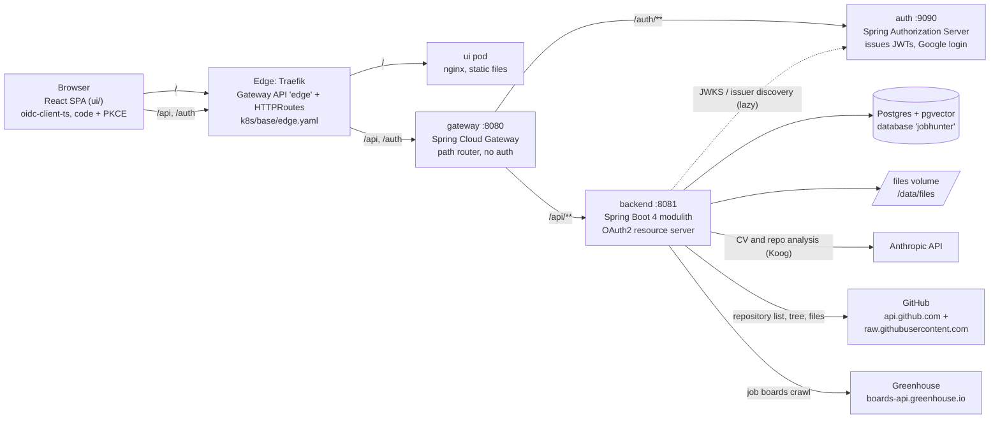
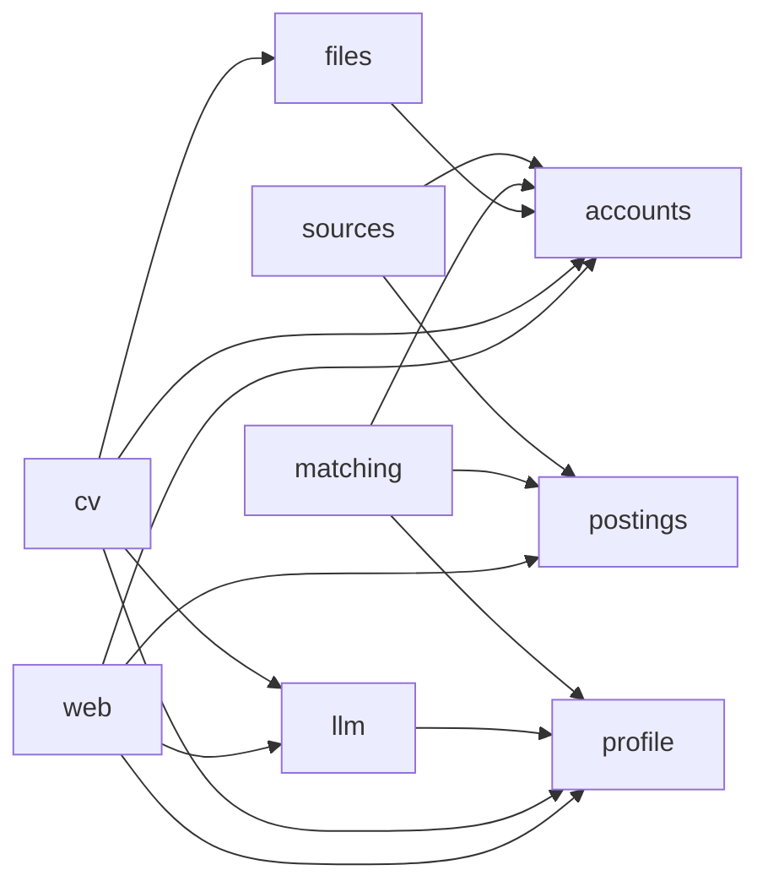
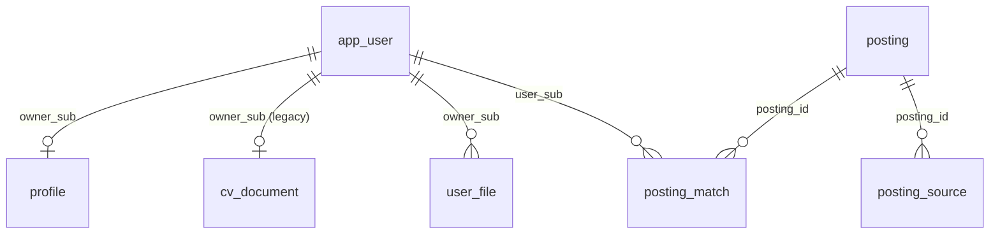

# Backend architecture

Scope: the `backend/` Gradle build only (the Spring Modulith application). Gateway, auth and ui appear only where the backend talks to them.
Read on 2026-10-24 from the files cited inline. Paths starting `backend/` are relative to the repository root; `K/` below is shorthand for
`backend/src/main/kotlin/net/s4v3/backend/`. Anything I did not confirm in a file is labelled "unverified".

## 1. The whole system

Sources: edge routes `k8s/base/edge.yaml` (`/` to `ui`, `/api` and `/auth` to `gateway`); gateway routes `gateway/src/main/resources/application.yaml`
(`Path=/api/**` to backend, port 8081 default; `Path=/auth/**` to auth, 9090 default); backend port 8081 in dev
`backend/src/main/resources/application-dev.yaml`; files volume `jobhunter.files.dir=/data/files`
(`backend/src/main/resources/application.yaml`, mount in `k8s/base/backend.yaml`); Postgres image `pgvector/pgvector:pg16`
(`k8s/base/postgres.yaml`). The gateway holds no token or session and does not authorise (`PLAN.md` section 2). The auth service has its own
database (`PLAN.md`; the auth datasource itself was not verified). The backend contacts Anthropic only through Koog in the `llm` module
(`K/llm/internal/KoogCvReader.kt`, `AnthropicLLMClient`). The `pgvector` extension is created by `001-baseline.sql`, but no table uses a vector
column yet (grep of the changelogs).

Key properties of the runtime: servlet MVC with JDBC on virtual threads (`spring.threads.virtual.enabled: true`, Hikari pool of 10, both in
`application.yaml`), one backend replica (the limiters, tickets and caches are in memory, see the comments in `K/web/internal/AnalysisLimiter.kt`
and `K/files/internal/DownloadTickets.kt`).

## 2. Module map

Spring Modulith rule used here: the package `net.s4v3.backend.<module>` is the module's public API; other modules may use only those types.
Everything under `<module>/internal/` (and any other sub-package) is private to the module. `ApplicationModules.verify()` enforces this
(section 8). The `notifications` module has only a `package-info.java` and no code
(`backend/src/main/java/net/s4v3/backend/notifications/package-info.java`); `applications` has Kotlin sources (below).
`cv` and `files` have no `package-info.java` but are still modules (Modulith treats every top-level package as one;
`ModularityTests.kt` asserts the eleven names).

"May call" below comes from the `import net.s4v3.backend.<other>` lines I counted in each module's main sources, not from a declared
`allowedDependencies` (none exists: grep found no `allowedDependencies` or `@NamedInterface` in `backend/src`).

Event edges (dotted, see section 5): `postings` publishes `JobIngested`, `profile` publishes `ProfileSaved`, both consumed by `matching`;
`accounts` publishes `UserRegistered` (no consumer).

### accounts

- Purpose: who is calling. Resource-server security, current user, user records.
- Public API (`K/accounts/`): `CurrentUser` (`id()` returns the token `sub`), `NoCurrentUserException`, event `UserRegistered`.
- Internal (`K/accounts/internal/`): `SecurityConfig` (filter chain, role mapping), `UserProvisioningFilter`, `UserProvisioner`, `JwtCurrentUser`,
  `IssuerSettingCheck` (fails startup if the issuer is not set, `test` profile exempt).
- Events: publishes `UserRegistered(userId, registeredAt)`; consumes none. No listener exists yet.
- Tables: `app_user`.
- May call: nothing.

### profile

- Purpose: the master profile (one JSON document per user), code-hosting lookups (repository list, repository digest) and the profile model.
- Public API (`K/profile/`): `ProfileService` (get, parse, replace; `ProfileInvalidException`, `ProfileConflictException`), `ProfileDirectory` (paged
  read of all profiles, for `matching`), `Profile.kt` (all model types: `Profile`, `StoredProfile`, `ProfileUpdate`, `OpenSourceProject`,
  `ProjectAnalysis`, `Skill`, `Preferences`, ...), `RepositoryCatalog`, `RepositoryDigestSource`, `RepositoryDigest`, `DigestResult`, event `ProfileSaved`.
- Internal (`K/profile/internal/`): `JdbcProfileService` (implements both `ProfileService` and `ProfileDirectory`), `ProfileValidator`,
  `ProfileJson`, `UsernameRules`, `DefaultRepositoryCatalog` and `DefaultRepositoryDigestSource` (validation plus in-memory cache, 5 and 10 minutes),
  `GitHubRepositoryProvider`, `GitHubDigestProvider`, `RepositoriesSettings`.
- Events: publishes `ProfileSaved(userId, version)`; consumes none.
- Tables: `profile`.
- May call: nothing in the application (HTTP to GitHub only).

### cv

- Purpose: two things on the saved data: read the master CV into a profile draft (extract), and render the saved profile as a CV file (export).
- Public API: no classes in the base package. `ExportService` and its types live in the sub-package `cv/export` (`K/cv/export/`). Nothing outside `cv` uses it.
  Whether Modulith treats `cv.export` as exposed or internal: unverified (by Modulith's documented rule a sub-package is internal).
- Internal: `K/cv/internal/` has `CvExtractController`, `CvExportController`, `CvText` (PDF/text to string), `ExtractionLimiter`, `ExportLimiter`,
  `CvSettings`, `ExportSettings`. `K/cv/export/internal/` has `DefaultExportService`, `RenderGuard`, `CvBuilder`, `Labels`, `MarkdownRenderer`,
  `HtmlRenderer`, `PdfRenderer`, `Templates`, `Html`.
- Events: none.
- Tables: none of its own. The legacy `cv_document` table is handled by `files` (`LegacyCvMover`).
- May call: `accounts`, `files` (`FileCabinet`), `llm` (`CvReader`, `LlmFailure`), `profile` (`ProfileService`, `Profile` types).

### files

- Purpose: the file cabinet. Any number of files per user, bytes on the volume, metadata in Postgres, one chosen master CV, ticket downloads.
- Public API (`K/files/FileCabinet.kt`): `FileCabinet.masterCv(sub)` returning `CabinetFile` (details and the `Path` of the bytes); `FileCabinet.image(sub, id)` returning the user's own JPEG of at most 6 MB, else null.
- Internal (`K/files/internal/`): `FilesController` (all `/api/files` endpoints), `JdbcFileRepository`, `FileStorage` (the only class touching the volume),
  `FileCabinetService`, `DownloadTickets`, `FileUploadGuards.kt` (`FreeSpaceGuard`, `FilesUploadLimitResolver`), `CvContent` (type from content),
  `OrphanSweep` (daily 03:30), `LegacyCvMover` (runs at startup), `FilesSettings`.
- Events: none.
- Tables: `user_file`; reads and deletes from the legacy `cv_document`.
- May call: `accounts`.

### llm

- Purpose: everything that talks to a language model. Only this module imports Koog (`KoogBoundaryTests`).
- Public API (`K/llm/`): `CvReader` (`profileFrom`, `sectionFrom`, `ProfileSection`), `ProjectAnalyst` (`analyze`), `LlmFailure` and `LlmFailureKind`
  (`NOT_CONFIGURED`, `FAILED`).
- Internal (`K/llm/internal/`): `KoogCvReader`, `KoogProjectAnalyst`, `AnthropicExecutorSource` (a seam so tests use a fake), `CvProfileDraft`,
  `SectionDrafts`, `ProjectAnalysisDraft`, `DraftMapper`, `AnalysisMapper`, `LlmSettings`.
- Events: none. Tables: none.
- May call: `profile` (types only).

### matching

- Purpose: the deterministic prefilter of postings against each profile, stored per user and posting.
- Public API: none (no classes in the base package; it is reached only through events and its own HTTP endpoint).
- Internal (`K/matching/internal/`): `MatchListeners`, `MatchEvaluator`, `Prefilter`, `MatchStore`, `MatchesController` (`GET /api/matches`), `MatchingSettings`.
- Events: consumes `JobIngested` and `ProfileSaved`; publishes none.
- Tables: `posting_match`.
- May call: `accounts`, `postings` (`PostingQuery`), `profile` (`ProfileService`, `ProfileDirectory`).

### postings

- Purpose: the shared store of canonical postings, with cross-source dedupe and language detection.
- Public API (`K/postings/`): `PostingIngest` (`PostingCandidate`, `IngestResult`, `PostingRejectedException`), `PostingQuery` (`Posting`, `PostingSearch`,
  `PostingLink`), `RemoteMode`, event `JobIngested`.
- Internal (`K/postings/internal/`): `JdbcPostings` (implements both interfaces), `Normalization`, `LanguageDetector` (Lingua, en/de/fr/it).
- Events: publishes `JobIngested(postingId, ingestedAt)` only for a new canonical posting; consumes none.
- Tables: `posting`, `posting_source`.
- May call: nothing.

### sources

- Purpose: fetch postings from outside boards and hand them to `postings`. Today only Greenhouse boards.
- Public API (`K/sources/AtsCrawl.kt`): `AtsCrawl.run()` returning `CrawlResult` / `BoardResult` / `BoardOutcome`.
- Internal (`K/sources/internal/`): `GreenhouseCrawl`, `PoliteHttp`, `RobotsTxt`, `FetchStateStore`, `CrawlScheduler` (+ `SchedulingConfig` with `@EnableScheduling`),
  `ScheduleStore`, `ScheduleRules`, `CrawlScheduleController` (`/api/admin/crawl-schedule`), `StartupCrawl`, `SourcesSettings`; `greenhouse/GreenhouseMapping.kt`,
  `greenhouse/Filters.kt` (`SwissLocation`, `RoleFilter`).
- Events: none (it calls `PostingIngest` directly). Tables: `source_fetch_state`, `crawl_schedule`.
- May call: `accounts`, `postings`.

### web

- Purpose: the REST controllers that did not get a home in a domain module, plus the OpenAPI header. It is not a gateway to everything: controllers also live in
  `cv`, `files`, `matching` and `sources`.
- Public API: none (only `internal`).
- Internal (`K/web/internal/`): `ProfileController` (`GET`/`PUT /api/profile`), `RepositoriesController` (`GET /api/profile/repositories`),
  `ProjectAnalysisController` (`POST /api/profile/open-source-projects/analyze`), `PostingsController` (`GET /api/postings`, `/api/postings/{id}`),
  `AnalysisLimiter`, `AnalysisSettings`, `OpenApiConfig`.
- Events: none. Tables: none.
- May call: `accounts`, `llm`, `postings`, `profile`.

### applications

- Purpose: the user's tracked jobs. A frozen copy of the posting (title, company, link, plain-text description, capture time), the stage (`INTERESTED`, `APPLYING`, `APPLIED`, `REJECTED`), notes and the applied date. Letters come later (the `motivation_letter` table exists, no code uses it yet).
- Public API: `ApplicationService` (`track`, `get`, `list`, `update`, `remove`, `byPosting`, `frozenJob`) and its types.
- Internal (`K/applications/internal/`): `ApplicationController` (`/api/applications`, `/by-posting`, `/{id}`), `DefaultApplicationService`, `ApplicationRepository`, `ErrorResponses`.
- Events: none. Tables: `application`, `motivation_letter` (`db/changelog/011-applications.sql`).
- May call: `accounts`, `postings`. No other module calls it.

### notifications

Empty module shell. The plan lists it (`PLAN.md` section 4), the code does not implement it.

### Where things live

The module `web` holds the HTTP controllers of profile (`ProfileController`), postings (`PostingsController`),
repositories (`RepositoriesController`) and project analysis (`ProjectAnalysisController`). Its `web/internal/` also has
`AnalysisLimiter`, `AnalysisSettings`, `ErrorResponses` and `OpenApiConfig`. The name is historical: `web` is not every HTTP
endpoint, the CV and file endpoints live in their own modules. The module `cv` holds CV extraction (`cv/internal`, with the
export and public-CV controllers beside it there), CV export (`cv/export`: the document model, the renderers and the export
service) and the public CV (`cv/publiccv`).

## 3. Main flows

### 3.1 Sign-in and token validation

1. The SPA signs the user in at the auth service with authorization code + PKCE (`ui/src/main.tsx` uses a `UserManager`; auth is behind `/auth`).
   Google login and local accounts are auth features (`auth/src/main/kotlin/net/s4v3/auth/google/GoogleOidcUserService.kt`).
2. Auth issues an access token with the claims `roles` (names without `ROLE_`), and `email` and `name` (`auth/src/main/kotlin/net/s4v3/auth/token/UserClaimsCustomizer.kt`).
3. The SPA calls `/api/...` with `Authorization: Bearer`. Edge and gateway forward the request unchanged.
4. In the backend, `SecurityConfig.securityFilterChain` (`K/accounts/internal/SecurityConfig.kt`) runs `oauth2ResourceServer { jwt }`. The issuer is the property
   `spring.security.oauth2.resourceserver.jwt.issuer-uri` (dev default `http://localhost:8080/auth`, `application-dev.yaml`; in the cluster from the secret
   `ISSUER_URI`, `k8s/base/backend.yaml`). Signing keys are discovered lazily, so the backend starts without auth being up.
5. `jwtAuthenticationConverter` maps the claim named by `app.security.roles-claim` (default `roles`) to authorities `ROLE_<name>`.
6. `UserProvisioningFilter` (added after `BearerTokenAuthenticationFilter`) takes the token's `sub`; a blank `sub` clears the context and answers 401. Otherwise it calls
   `UserProvisioner.ensureExists(sub, email, name)`: `INSERT ... ON CONFLICT (sub) DO NOTHING` into `app_user`; only the call that inserted publishes `UserRegistered`.
7. Controllers ask `CurrentUser.id()` (`JwtCurrentUser`) for the `sub`. No other module reads the token (`TokenAccessBoundaryTests`).
8. The authorisation rules are in section 6.

### 3.2 Save profile with version check

1. `PUT /api/profile` (`K/web/internal/ProfileController.kt`) reads the raw body with a size cap `ProfileService.MAX_BODY_BYTES` = 256 KiB (413 above it).
   Note: the `@ApiResponse` text on that endpoint says "larger than 128 KiB", the constant is `256 * 1024` (`K/profile/ProfileService.kt`). Documentation drift.
2. `ProfileService.parse` (`JdbcProfileService` calls `ProfileJson.parseUpdate`): strict parsing, unknown fields and enum values rejected.
3. `JdbcProfileService.replace(sub, update)` (one transaction): `ProfileValidator.validate` (rules named, never values; failures become `ProfileInvalidException`, mapped
   to 400 `validation_failed` with `fields` by `ProfileErrors`).
4. Version check inside the SQL: version 0 does `INSERT ... ON CONFLICT (owner_sub) DO NOTHING`; version n does `UPDATE profile ... WHERE owner_sub = :sub AND version = :version`
   and sets `version = version + 1`. Zero rows changed throws `ProfileConflictException`, mapped to 409 `version_conflict`.
5. On success `ProfileSaved(sub, version + 1)` is published (no profile content); the response is the `StoredProfile` with the new version.
6. `matching` re-evaluates all postings for that user (flow 3.6).
`GET /api/profile` returns the stored profile or an empty one at version 0.

### 3.3 Extract CV (profile draft from the master CV)

`POST /api/cv/extract[?section=experience|education|publications]` (`K/cv/internal/CvExtractController.kt`):
1. Unknown `section`: 400. Then `FileCabinet.masterCv(sub)`; none: 409 "Choose a master CV in your files first."
2. Read the file (a size above 5 MB counts as no text), `CvText.of` extracts text (PDFBox for PDF, no OCR; UTF-8 otherwise); empty: 422.
3. Text longer than `jobhunter.cv.max-text-chars`: 413 (never truncated).
4. `ExtractionLimiter.tryAcquire(sub)` (default 20 per rolling hour): else 429. The check runs after the cheap checks, so a refused request does not use a slot.
5. `CvReader.profileFrom(text)` or `sectionFrom(text, section)` is `KoogCvReader`: no key or unknown model name gives `LlmFailure(NOT_CONFIGURED)`; otherwise one structured Koog request
   (manual JSON mode, `CvProfileDraft` or a section draft), timeout `jobhunter.llm.timeout`, and a repair parser on `Haiku_4_5` with `jobhunter.llm.repairs` retries.
6. `DraftMapper.toProfile` turns the draft into a `Profile`. The controller returns it; nothing is stored. The UI shows it and the user saves with `PUT /api/profile`.
7. `NOT_CONFIGURED` becomes 503, `FAILED` becomes 502. Logs hold lengths, timings and class names only.

### 3.4 List and pick repositories, analyse one

1. `GET /api/profile/repositories?provider=GITHUB&username=...` (`K/web/internal/RepositoriesController.kt`): `RepositoryCatalog.list`. `DefaultRepositoryCatalog`
   validates the username, uses a 5 minute in-memory cache, and calls `GitHubRepositoryProvider` (`/users/<name>/repos?type=owner&sort=pushed&per_page=100`).
   Results are sealed (`Found`, `InvalidUsername`, `NotFound`, `RateLimited`, `Unavailable`) and each maps to a fixed error code.
2. The user picks projects in the UI; they are stored as `OpenSourceProject` snapshots inside the profile through flow 3.2 (the catalog itself writes nothing).
3. `POST /api/profile/open-source-projects/analyze` (`K/web/internal/ProjectAnalysisController.kt`): validates `owner/repo`; checks that the project is in the caller's
   saved profile (404 `project_not_found`); `AnalysisLimiter` (default 10 per hour, 429); `RepositoryDigestSource.digest` (`DefaultRepositoryDigestSource`, 10 minute cache, one
   tree call and one request per file through `GitHubDigestProvider`, limits from `jobhunter.repositories.digest.*`).
4. `ProjectAnalyst.analyze(digest)` is `KoogProjectAnalyst`; `AnalysisMapper.toAnalysis` keeps a technology only if the file path it cites is in the digest's tree or is the README.
5. The response is the `ProjectAnalysis`; the profile is not changed, the client saves it.

### 3.5 Export a CV

`POST /api/cv/export` (`K/cv/internal/CvExportController.kt`):
1. Strict JSON (`ExportRequest`: `format`, `template`, `language`, optional `sections`, `includeOpenSource`, `includeAnalysis`, `includeWorkAuthorisation`). An unknown field, such as a `profile`, is refused (400).
2. `ExportLimiter` (default 30 per hour, 429).
3. `DefaultExportService.export(sub, options)` loads the saved profile with `ProfileService.get(sub)` (never from the request). No `contact.fullName`: `NameRequiredException`, 409 `name_required`.
4. `CvBuilder.build` produces a `CvDocument` (labels in EN or DE from `Labels`); then `MarkdownRenderer`, `HtmlRenderer`, or `PdfRenderer` (renders the HTML, bundled fonts).
5. PDF only: `RenderGuard` allows 2 parallel renders and waits 5 s for a free slot; failing that, `ExportBusyException`, 503 `busy`. Any other throwable (but not `VirtualMachineError`) becomes
   `ExportFailedException`, 500 `render_failed`, logging only the class name. Output over 5 MiB is a failure too.
6. The response is an attachment `<slug>-cv-<lang>.<ext>` with `Cache-Control: no-store`.
More on the pipeline: `docs/cv-export.md`.

### 3.6 Crawl a source, ingest postings, match

1. Trigger. `CrawlScheduler.tick` runs every `jobhunter.sources.schedule.tick` (default 30 s). It reads `ScheduleStore.current()` (the single `crawl_schedule` row, else
   `jobhunter.sources.schedule.*`), recomputes the next fire time from "now" with `ScheduleRules.nextFire` (a missed time is never made up), and when due starts
   `AtsCrawl.run()` on a virtual thread; a second start while one runs is skipped. `StartupCrawl` can also run once after startup when `jobhunter.sources.greenhouse.run-on-startup=true`.
   An admin changes the schedule with `POST /api/admin/crawl-schedule` (`CrawlScheduleController`; cron must fire no more often than `min-interval`).
2. `GreenhouseCrawl.run` goes board by board (`jobhunter.sources.greenhouse.boards`). Per board: token must match `[A-Za-z0-9_-]+`; a Postgres advisory lock
   `crawl:greenhouse-<board>` (otherwise `ALREADY_RUNNING`); `FetchStateStore` says `TOO_SOON` if the last run was under `min-interval` ago; `robots.txt` is read once per host
   (unreadable: `FAILED`, 404: allow all) and must allow the path (else `BLOCKED_BY_ROBOTS`).
3. `PoliteHttp.get` fetches the job list with `If-None-Match` (304 gives `NOT_MODIFIED`); it sends a fixed User-Agent, refuses redirects, caps the body, and serialises requests per host with a pause.
4. Each listed job passes `SwissLocation.find` and `RoleFilter.isIt`, else it counts as `filteredOut`. For the rest the detail is fetched and `GreenhouseMapping.toCandidate` builds a `PostingCandidate`.
5. `PostingIngest.ingest` (`JdbcPostings`, one transaction, advisory transaction lock per (source, source id)): known (source, id) means `refresh`: only the primary source may change the canonical
   fields, an equal `content_hash` is `UNCHANGED`, otherwise `UPDATED`. Unknown means `insert`: if the `dedupe_key` (company, title, city, normalised) matches an existing posting, only a non-primary
   `posting_source` row is added (`CREATED`, no event); else a new `posting` is stored with language detection and `JobIngested` is published.
6. The list `ETag` is saved only if every detail was read, so a failed job is retried next run.
7. `MatchListeners.on(JobIngested)` calls `MatchEvaluator.evaluatePosting`: pages through `ProfileDirectory` (100 at a time), runs `Prefilter.evaluate` for each user and `MatchStore.upsert`s the result into `posting_match`.
   One failing user does not stop the others; if all fail the listener throws so the publication stays incomplete.
8. `MatchListeners.on(ProfileSaved)` calls `evaluateProfile(sub)`: every posting against that user's profile; it stops if a newer profile version appears.
9. `GET /api/matches` returns the caller's passing matches, best score first.
Prefilter (`K/matching/internal/Prefilter.kt`): hard rules (out of scope, canton, workload overlap, remote mode, minimum salary; an unknown posting value never fails) then a score
(role words in the title up to 50, skills up to 40 at 5 hits, language level B2 or better 10); passes when no hard rule failed and score >= `jobhunter.matching.threshold`.

Async delivery: the listeners use Modulith's `@ApplicationModuleListener`. The main sources contain no `@EnableAsync` (grep), and the tests that need asynchronous delivery add it themselves
(`EventPublicationRegistryTests.kt`, `PostingIngestTests.kt`). Whether the listeners run on the publishing thread in production: unverified (depends on Modulith's own configuration).

## 4. Data model

Liquibase master `backend/src/main/resources/db/changelog/db.changelog-master.yaml` includes files `001` to `008` in order. Changeset ids are numbered separately (001 to 011).
The event table is owned by Liquibase: `spring.modulith.events.jdbc.schema-initialization.enabled: false`.

| Table | File (changeset) | Key | Content |
| --- | --- | --- | --- |
| `event_publication` | `001-baseline.sql` (002) | `id` UUID | Modulith's event registry: listener id, event type, serialized event, completion date |
| `app_user` | `001-baseline.sql` (003) | `sub` | email, display name, created_at |
| `profile` | `002-profile.sql` (004) | `owner_sub` FK `app_user` cascade | `document` JSONB, `schema_version`, `version` (optimistic lock), updated_at |
| `posting` | `003-postings.sql` (005) | `id` UUID | canonical posting, `raw_payload`, `content_hash`, `dedupe_key` (not unique), `out_of_scope`, `needs_review`, `language`, first/last seen. Shared, no owner |
| `posting_source` | `003-postings.sql` (006) | `id`; unique (`source_id`, `source_posting_id`) | FK `posting` cascade, `url`, `is_primary`, last_seen |
| `source_fetch_state` | `004-sources.sql` (007) | `source_id` | `etag`, `last_run_at`. No personal data |
| `crawl_schedule` | `005-crawl-schedule.sql` (008) | `id` with CHECK `id = 1` | enabled, cron, zone, updated_at, `updated_by` (a `sub`) |
| `posting_match` | `006-matching.sql` (009) | (`user_sub`, `posting_id`) | FKs cascade, `passed`, `score` 0..100, `reasons` TEXT[], `profile_version`, evaluated_at |
| `cv_document` | `007-cv.sql` (010) | `owner_sub` | legacy single CV (bytes in the row, max 5 MiB). Drained by `LegacyCvMover` into `user_file`; the table still exists |
| `user_file` | `008-files.sql` (011) | `id` UUID | FK `app_user` cascade, `name`, `kind` CV/OTHER, `content_type`, `size_bytes` (<= 10 GiB), `sha256`, unique `storage_key`, `master`; unique partial index allows one master per owner; CHECK master only for CV |

`crawl_schedule`, `source_fetch_state` and `event_publication` have no relations. Per-user rows cascade on user deletion; account deletion itself is not implemented in the backend (no code found: unverified by absence).
Postings are the only shared domain data.

## 5. Events

| Event | Publisher | Where | Consumer | Payload |
| --- | --- | --- | --- | --- |
| `UserRegistered` | accounts | `UserProvisioner.ensureExists` | none | `userId`, `registeredAt` |
| `ProfileSaved` | profile | `JdbcProfileService.replace` | `matching` (`MatchListeners`) | `userId`, `version` |
| `JobIngested` | postings | `JdbcPostings.insert` (new canonical only) | `matching` (`MatchListeners`) | `postingId`, `ingestedAt` |

Payloads carry identifiers only. Publications are persisted in `event_publication`; `EventPublicationRegistryTests` checks that a failed listener leaves the entry incomplete across a restart.
Whether anything resubmits incomplete publications in production: unverified (no resubmission code or setting found by grep for `resubmit` and `incomplete` in `backend/src/main`).

## 6. Security model

- Resource server only: JWT from the auth service, validated by issuer URI and keys; stateless, CSRF off, HTTP basic and form login off (`SecurityConfig`).
- Public paths (no token): `GET /actuator/health/**`; when `jobhunter.api-docs.enabled` (default true): `GET /api/openapi.json`, `/api/openapi.json/swagger-config`, `/api/docs`, `/api/docs/**`, `/api/swagger-ui/**`;
  `GET /api/files/*/content`, where `FilesController.content` itself accepts a bearer token or a single-use ticket and answers 401 otherwise.
- Roles: `/api/admin/**` needs `ROLE_ADMIN` (today only the crawl schedule). `@EnableMethodSecurity` is on, no `@PreAuthorize` use was checked. Everything else: any authenticated user.
- Other management endpoints are not exposed (`management.endpoints.web.exposure.include: health`). Liveness does not include the database; readiness does (`application.yaml`).
- Per-user scoping: controllers take the user from `CurrentUser.id()`, never from a path or parameter. Stores filter by `owner_sub` / `user_sub`. A file of another user answers 404; a delete of an unknown id answers 204 (`FilesController`).
  Postings are shared and readable by any signed-in user.
- Architecture rules (ArchUnit): only `accounts` may touch `Jwt` or `SecurityContextHolder` (`TokenAccessBoundaryTests`); only `llm` may use `ai.koog` (`KoogBoundaryTests`).
- Rate limiters (all in memory, per `sub`, rolling hour, one instance): `ExtractionLimiter` (`jobhunter.cv.extractions-per-hour`, 20), `ExportLimiter` (`jobhunter.cv-export.per-hour`, 30), `AnalysisLimiter`
  (`jobhunter.analysis.per-hour`, 10). The three classes have the same body (read all three). A restart resets them. Other limits: `RenderGuard` (2 PDF renders), `PoliteHttp` (per host pause),
  `FreeSpaceGuard` (507 when an upload would leave under `min-free-bytes`).
- Privacy habits that the code states in comments: error bodies use fixed codes or messages, no profile, CV or posting text in logs, tokens and tickets never logged, `LlmSettings.toString` hides the API key.
  Download tickets: 32 random bytes, bound to user and file, one use, 60 s (`DownloadTickets`).

## 7. Configuration index

Defaults come from the `@ConfigurationProperties` classes; where `application.yaml` differs, both are shown. Set in the cluster through environment variables (Spring relaxed binding, for example `JOBHUNTER_FILES_DIR`).

| Property | Default | Meaning |
| --- | --- | --- |
| `jobhunter.llm.api-key` | `${ANTHROPIC_API_KEY:}` (empty) | Anthropic key; empty gives `NOT_CONFIGURED` (503). Never logged |
| `jobhunter.llm.model` | class `Sonnet_5`; `application.yaml` sets `Haiku_4_5` | Koog model constant (`Haiku_4_5`, `Sonnet_5`, `Opus_5`) |
| `jobhunter.llm.repairs` | 2 | repair attempts on a malformed model answer |
| `jobhunter.llm.timeout` | 90 s | whole model call |
| `jobhunter.cv.max-text-chars` | 120000 | longest CV text sent to the model; longer is refused |
| `jobhunter.cv.extractions-per-hour` | 20 | CV extractions per user per hour |
| `jobhunter.cv-export.per-hour` | 30 | CV exports per user per hour |
| `jobhunter.analysis.per-hour` | 10 | project analyses per user per hour |
| `jobhunter.api-docs.enabled` | true | OpenAPI JSON and Swagger UI (also drives the public paths and `springdoc.*`) |
| `jobhunter.files.dir` | `/data/files` | files volume root |
| `jobhunter.files.min-free-bytes` | 2147483648 (2 GiB) | space uploads must leave free |
| `jobhunter.files.max-other-bytes` | 10737418240 (10 GiB) | limit for kind `OTHER` |
| `jobhunter.files.max-cv-bytes` | 5242880 (5 MB) | limit for kind `CV` |
| `jobhunter.files.ticket-seconds` | 60 | download ticket lifetime |
| `jobhunter.matching.threshold` | 30 | lowest passing score |
| `jobhunter.repositories.user-agent` | `JobHunter/0.1 (+https://s4v3.net)` | User-Agent for GitHub calls |
| `jobhunter.repositories.github.base-url` | `https://api.github.com` | GitHub API |
| `jobhunter.repositories.github.raw-base-url` | `https://raw.githubusercontent.com` | raw file host |
| `jobhunter.repositories.github.connect-timeout` / `read-timeout` | 5 s / 10 s | HTTP timeouts |
| `jobhunter.repositories.github.max-body-bytes` | 2 MiB | response cap |
| `jobhunter.repositories.digest.max-tree-body-bytes` | 8 MiB | tree response cap |
| `jobhunter.repositories.digest.max-tree-paths` / `max-tree-depth` | 400 / 3 | tree cut-offs |
| `jobhunter.repositories.digest.max-readme-bytes` | 20 KiB | README cap |
| `jobhunter.repositories.digest.max-manifests` / `max-manifest-bytes` | 8 / 12 KiB | build files read |
| `jobhunter.sources.user-agent` | `JobHunter/0.1 (+https://s4v3.net)` | User-Agent for crawls |
| `jobhunter.sources.pause` | 1 s | pause between requests to one host |
| `jobhunter.sources.min-interval` | 15 min | minimum gap between runs of one board, and minimum cron gap |
| `jobhunter.sources.connect-timeout` / `read-timeout` | 5 s / 30 s | HTTP timeouts |
| `jobhunter.sources.max-list-bytes` / `max-job-bytes` | 8 MiB / 1 MiB | body caps |
| `jobhunter.sources.greenhouse.base-url` | `https://boards-api.greenhouse.io` | Greenhouse API |
| `jobhunter.sources.greenhouse.boards` | ten board tokens (see `SourcesSettings.kt`) | boards to crawl; the `test` profile sets it empty |
| `jobhunter.sources.greenhouse.it-keywords` / `excluded-keywords` | lists in `SourcesSettings.kt` | title filters |
| `jobhunter.sources.greenhouse.run-on-startup` | false | one crawl after startup |
| `jobhunter.sources.schedule.enabled` | false | initial schedule on/off; a stored schedule replaces it |
| `jobhunter.sources.schedule.cron` | `0 0 * * * *` | initial cron (hourly) |
| `jobhunter.sources.schedule.zone` | `Europe/Zurich` | cron time zone |
| `jobhunter.sources.schedule.tick` | `PT30S` | scheduler poll interval; read only by `@Scheduled` in `CrawlScheduler`, not by `SourcesSettings` |
| `app.security.roles-claim` | `roles` | token claim that holds the roles |

Related Spring settings in `application.yaml`: `spring.threads.virtual.enabled`, `spring.datasource.hikari.maximum-pool-size: 10`, `spring.servlet.multipart.max-file-size` and `max-request-size` 10GB, multipart `location` `${jobhunter.files.dir}/tmp`,
`spring.modulith.events.jdbc.schema-initialization.enabled: false`, `management.*`, `springdoc.*`, `logging.level.ai.koog: "OFF"`. Dev profile (`application-dev.yaml`): `ISSUER_URI`, `server.port: 8081`, optional `backend/.env`.
Required in every non-test run: `spring.security.oauth2.resourceserver.jwt.issuer-uri` (`IssuerSettingCheck`). Datasource URL: in the cluster `jdbc:postgresql://postgres:5432/jobhunter` (`k8s/base/backend.yaml`); in dev from docker-compose.

## 8. How Modulith verification works here

- `BackendApplication` (`K/BackendApplication.kt`) is the root; each direct sub-package is a module. `package-info.java` with `@ApplicationModule(displayName=...)` and `@NullMarked` exists for the modules that have one.
- `ModularityTests.kt`: `ApplicationModules.of(BackendApplication::class.java).verify()` (no cycles, no use of another module's non-exposed types) and an assertion that the module set is exactly the eleven names.
- `ModuleViolationTests.kt` proves the check bites: it verifies a deliberately broken fixture (`backend/src/test/kotlin/net/s4v3/fixture/modules/`, modules `alpha` and `beta`) and asserts the error names both modules, for "non-exposed" access and for a cycle.
- `KoogBoundaryTests.kt` and `TokenAccessBoundaryTests.kt` are plain ArchUnit rules, each with a failing fixture (`fixture/koog`, `fixture/token`).
- None of these four needs Docker or a Spring context (by reading: they build models from classes). Declared `allowedDependencies`: none, so any module may use any other module's public API as long as there is no cycle.

## 9. Where the tests live

All under `backend/src/test/kotlin/net/s4v3/backend/` (86 entries in that folder, files and subfolders, plus `llm/`, `profile/internal/`, `cv/export/internal/`). The `build.gradle.kts` has one `test` task with `useJUnitPlatform()` and no tiers yet; the planned split into
fast and integration is in `openspec/changes/fast-build-and-code-map/design.md`. `design.md` counts 573 tests in 89 classes.

- `@IntegrationTest` (`IntegrationTest.kt`): meta-annotation = `@SpringBootTest` + `@Import(TestcontainersConfiguration)` + `@ActiveProfiles("test")`. `TestcontainersConfiguration` starts `pgvector/pgvector:pg16` as a `@ServiceConnection` bean, so
  Liquibase runs for real. Needs Docker. Profile `test` (`application-test.properties`) sets a dummy issuer and no Greenhouse boards.
- `@ApiTest` (`ApiTest.kt`): `@IntegrationTest` + `@AutoConfigureMockMvc` + a mock OAuth2 issuer shared by the whole JVM (`SharedMockIssuer`, `MockIssuer.kt`) + test endpoints. Used for HTTP-level tests with real token validation
  (`*ApiTests`, `ResourceServerTests`, `PerUserIsolationTests`, `ApiDocsContentTests`).
- Schema and store tests on the real database: `*SchemaTests`, `DatabaseBaselineTests`, `FileRepositoryTests`, `ScheduleStoreTests`, `FetchStateStoreTests`, `PostingIngestTests`, `PostingSearchTests`, `MatchingFlowTests`.
- Logging tests (`*LoggingTests`) assert that no personal data reaches the logs (by name; one read: `llm/LlmLoggingTests.kt` is an `@IntegrationTest`).
- Own-context tests (do not use `@IntegrationTest`, build the application or a container themselves; found by grep for `SpringBootTest`/`Testcontainers`): `EventPublicationRegistryTests` (starts the app twice on one database, read), `CrawlSchedulerWiringTests`,
  `DatabaseOutageHealthTests`, `FailingMigrationTests` (the last three by name and grep only); `IssuerSettingTests` starts the app with `SpringApplicationBuilder` (read, first lines).
- Fast unit tests, no Spring context (by file name; I did not read each): `PrefilterTests`, `NormalizationTests`, `LanguageDetectorTests`, `ScheduleRulesTests`, `RobotsTxtTests`, `GreenhouseMappingTests`, `GreenhouseFilterTests`, `CrawlSchedulerTests`,
  `CvBuilderTests`, `LabelsTests`, `MarkdownRendererTests`, `cv/export/internal/HtmlRendererTests` and `PdfRendererTests`, `CvContentTests`, `FileStorageTests`, `llm/DraftMapperTests`, `llm/AnalysisMapperTests`, `llm/KoogCvReaderTests`,
  `llm/KoogProjectAnalystTests` (with `FakePromptExecutor`), `profile/internal/ProfileValidatorTests`, `RepositoryCatalogTests`, `RepositoryDigestSourceTests`, `GitHub*ProviderTests`, `PoliteHttpTests` (a local `HttpServer`, read).
- Architecture tests: section 8.
- Fakes and helpers: `FakeGreenhouse.kt` (local Greenhouse), `ai/koog/fake/FakeKoogClient.kt`, `llm/FakePromptExecutor.kt`, `MatchingTestSupport.kt`, `TestEndpoints.kt`.
- Real network is not used: Anthropic is faked through `ExecutorSource`, GitHub and Greenhouse through local servers (stated by the `base-url` settings being overridable; the fakes' use per test was not checked for every class).
